# ERD — skema `core`

Diturunkan dari [internal/database/migrations/core](../../internal/database/migrations/core)
(migration `000001`–`000005`): 6 tabel, 1 enum, 1 function.



| File | Fungsi |
|---|---|
| [core.mmd](core.mmd) | Sumber Mermaid — **edit file ini**, lalu render ulang |
| [core.svg](core.svg) | Hasil render vektor (tajam saat di-zoom) |
| [core.png](core.png) | Hasil render raster, langsung terbuka di VS Code |

## Cara membaca

| Simbol | Arti |
|---|---|
| Garis solid | `FOREIGN KEY` constraint di database |
| Garis putus-putus | Referensi logis **tanpa FK**, divalidasi di service layer |
| `\|\|` / `\|o` | Tepat satu / nol atau satu (kolom FK nullable) |
| `o{` | Nol atau banyak |
| `audit standard_columns` | `created_at`, `created_by`, `updated_at`, `updated_by`, `deleted_at`, `deleted_by` — soft delete |

Kolom `created_by` / `updated_by` / `deleted_by` adalah UUID user tanpa FK dan tidak
digambar sebagai relasi.

Warna menandai domain:

| Warna | Domain | Tabel |
|---|---|---|
| Biru | Identity & auth | `users`, `refresh_tokens`, `user_identities`, `api_keys` |
| Oranye | RBAC | `roles`, `user_roles` |

## Model akses

Aplikasi ini single-tenant: tidak ada client, company, atau branch. Akses ditentukan
sepenuhnya oleh role global.

```
users ── user_roles ── roles (permissions JSONB)
  ├─ api_keys        (milik satu user, scope ⊆ permission user)
  ├─ refresh_tokens
  └─ user_identities (Google, dst.)
```

User hasil signup (email maupun Google) tidak mendapat role apa pun sampai
super_admin memberikannya.

## Catatan desain

- **Soft delete + partial unique index.** Unique pada `email`, `username`, `roles.code`,
  `key_id`, dll. hanya berlaku `WHERE deleted_at IS NULL`, sehingga nilai bisa dipakai
  ulang setelah soft delete.
- **Satu sumber role.** `user_roles` adalah satu-satunya tempat penugasan role. Permission
  efektif user = gabungan permission semua role aktifnya, di-cache di Redis per user
  (lihat [authz/service.go](../../internal/shared/authz/service.go)).

## Enum & function

| Nama | Isi |
|---|---|
| `core.api_key_environment` | `live`, `test` |
| `core.has_permission(permissions, resource, level)` | Cek isi JSONB `roles.permissions` |

## Render ulang

Setelah menambah migration, perbarui `core.mmd`, lalu jalankan dari root repo:

```bash
npx -y @mermaid-js/mermaid-cli@11.17.0 -i docs/erd/core.mmd -o docs/erd/core.svg -b white -w 2400
npx -y @mermaid-js/mermaid-cli@11.17.0 -i docs/erd/core.mmd -o docs/erd/core.png -b white -w 2400 -s 2
```

Perintah pertama mengunduh Chromium untuk Puppeteer. Kalau Google Chrome sudah
terpasang, set `PUPPETEER_SKIP_DOWNLOAD=1` dan arahkan ke Chrome lewat
`-p puppeteer.json` berisi `{"executablePath": "/Applications/Google Chrome.app/Contents/MacOS/Google Chrome"}`.
